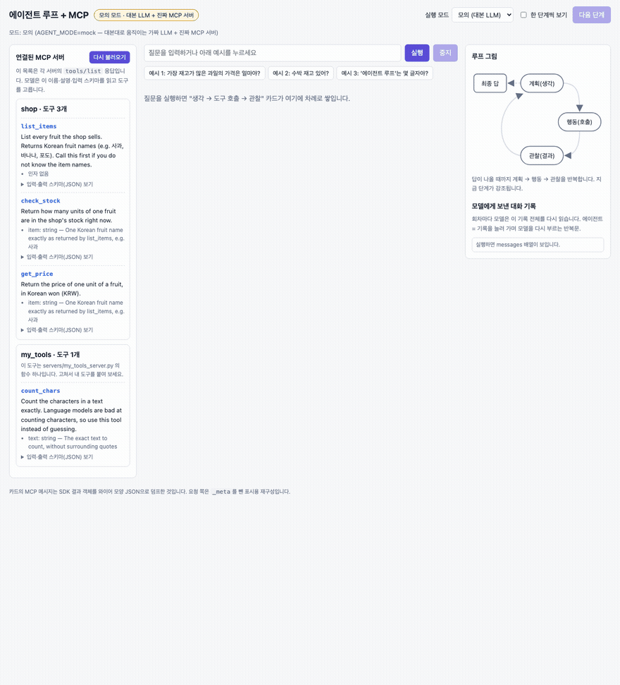
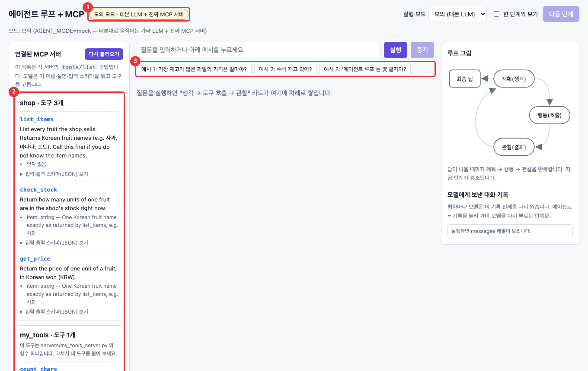
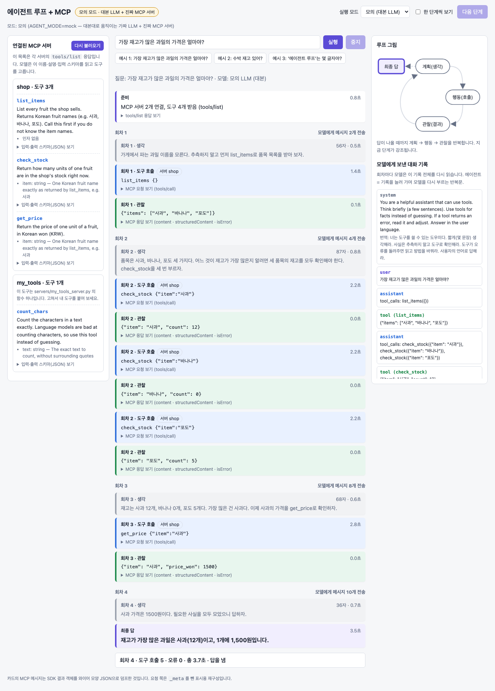
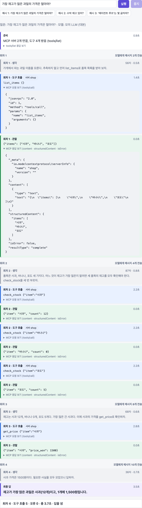
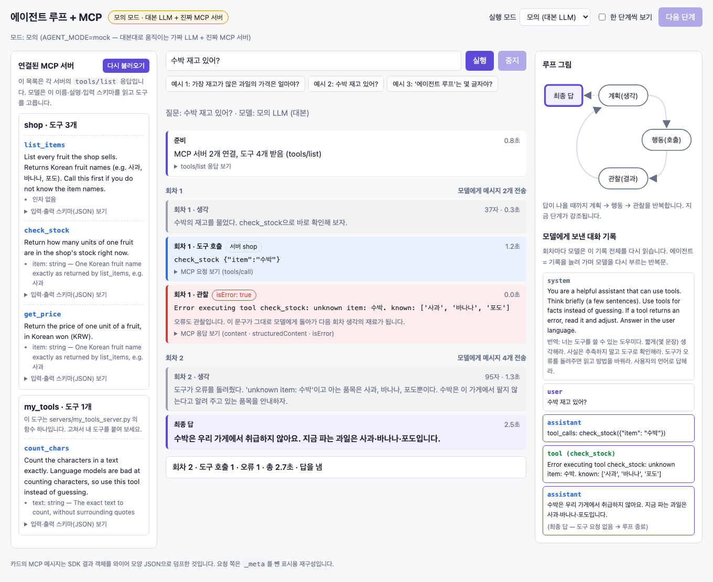
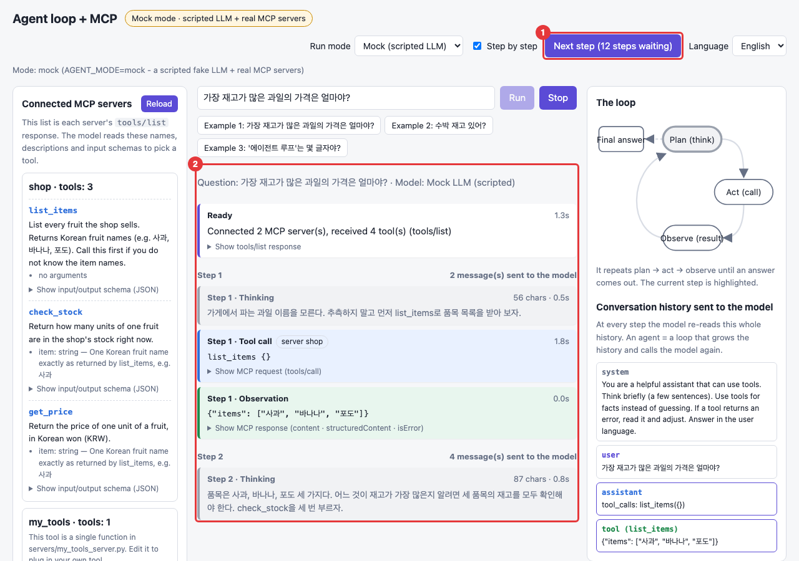
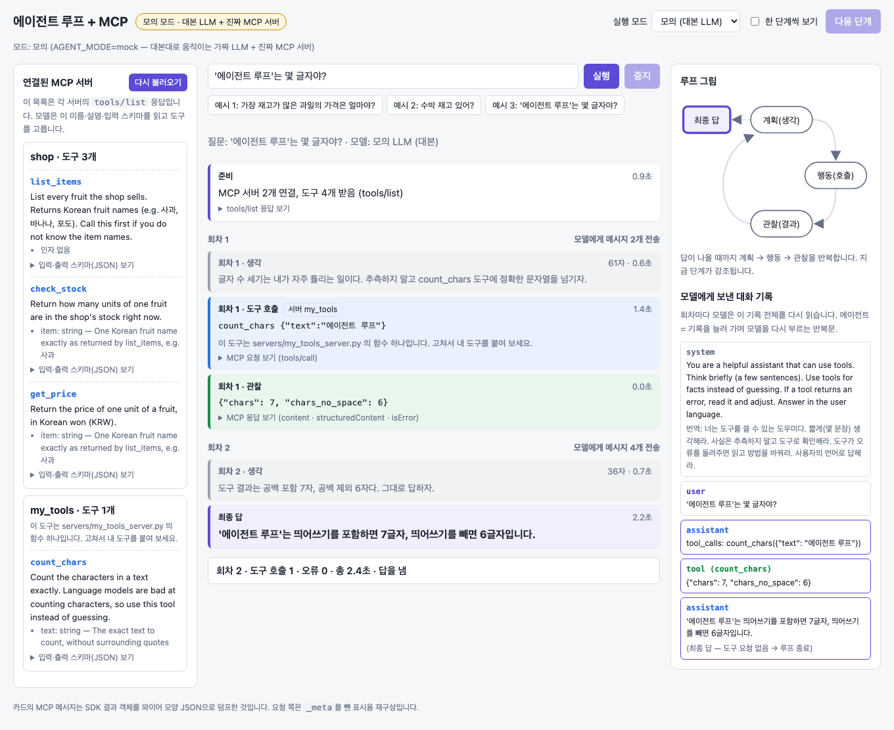
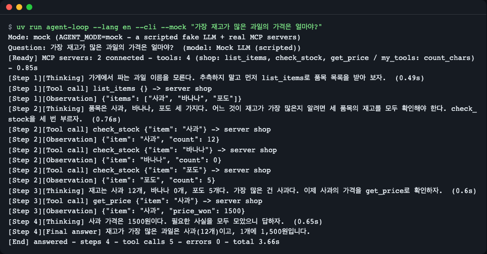
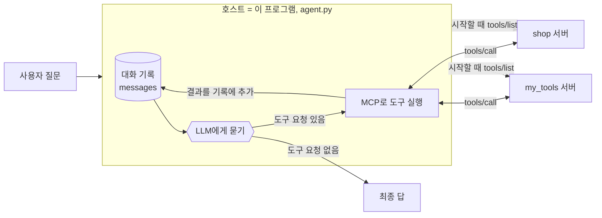

# 에이전트 루프와 MCP — 도구를 쓰는 AI가 어떻게 움직이는지 한 단계씩 보기

[English](README.md) | **한국어**


<sub>질문 하나를 넣으면 "생각 → 도구 호출 → 관찰" 카드가 쌓이고, 오른쪽 대화 기록이 한 줄씩 늘어납니다. (모의 모드 녹화)</sub>

## 한 줄 요약

AI에게 질문을 던지면 AI가 "이 도구를 불러 줘"라고 요청하고, 프로그램이 도구를 실행해 결과를 돌려주고, AI가 그 결과를 읽고 다시 생각하는 **반복문**을 눈으로 확인합니다. 도구를 꽂는 표준 규격인 **MCP**도 함께 만져 봅니다.

**이런 분께:**
- "AI 에이전트"라는 말은 들어 봤지만 안에서 무슨 일이 벌어지는지 모르는 분
- MCP가 무엇이고 왜 "표준"이라고 하는지 궁금한 분
- 내 함수를 AI의 도구로 붙여 보고 싶은 분

## 왜 알아야 하나요?

신입 직원에게 "가장 재고가 많은 과일의 가격이 얼마예요?"라고 물었다고 해 봅시다. 직원은 재고를 외우고 있지 않습니다. 그래서 먼저 품목 목록을 찾아보고, 품목마다 재고를 확인하고, 가장 많은 것의 가격을 다시 찾아본 뒤에야 답합니다. 중간에 "수박은 없네요"처럼 막히면 다른 방법을 찾습니다.

AI 에이전트가 하는 일이 이것입니다. 모델 혼자서는 우리 가게의 재고를 알 수 없으므로, **찾아보고 → 확인하고 → 다시 생각하는** 과정을 반복합니다. 이때 직원이 쓰는 "재고 장부, 가격표" 같은 도구를 AI 프로그램에 꽂는 **공통 규격**이 MCP입니다. 규격이 같으면 한 번 만든 도구를 다른 앱에도 그대로 꽂을 수 있습니다.

## 30초 만에 실행하기

준비물: [git](https://git-scm.com/downloads) + [uv](https://docs.astral.sh/uv/) (실제 모델 모드에만 [Ollama](https://ollama.com) 필요)

uv가 없다면 먼저 설치합니다. **Python 3.14는 따로 설치하지 않아도 됩니다.** PC에 없으면 uv가 첫 실행 때 자동으로 내려받습니다.

```bash
# macOS / Linux
curl -LsSf https://astral.sh/uv/install.sh | sh
```

```powershell
# Windows (PowerShell)
powershell -ExecutionPolicy ByPass -c "irm https://astral.sh/uv/install.ps1 | iex"
```

설치 후 터미널을 새로 열고 아래를 실행합니다.

```bash
git clone https://github.com/LeeGyeongPil/ai-lab-agent-loop-mcp.git
cd ai-lab-agent-loop-mcp
uv run agent-loop --mock
```

터미널에 아래 두 줄이 나오고 브라우저가 열립니다. 끝내려면 `Ctrl+C`를 누르세요.

```text
모드: 모의 (AGENT_MODE=mock — 대본대로 움직이는 가짜 LLM + 진짜 MCP 서버)
주소: http://127.0.0.1:8765  (끝내려면 Ctrl+C)
```

브라우저가 열리지 않으면 위 주소를 직접 여세요. 처음 실행할 때는 uv가 패키지를 내려받느라 시간이 조금 걸립니다.

**모의 모드란?** AI 모델 자리에 "대본대로 말하는 가짜 모델"을 둔 모드입니다. 모델이 없어도 돌아가고 결과가 매번 같습니다. 다만 도구 쪽(MCP 서버)은 **진짜**입니다. 서버 프로세스가 실제로 뜨고, 메시지를 실제로 주고받습니다.


<sub>첫 화면입니다. ① 지금 모드 ② 서버가 알려 준 도구 목록 ③ 눌러 보는 예시 질문.</sub>

실제 로컬 모델로 돌려 보려면 (모델 약 2.5GB를 내려받습니다):

```bash
ollama pull qwen3:4b
uv run agent-loop --real
```

## 단계별로 따라 하기

### 1단계. 첫 화면에서 "도구 목록" 보기

화면 왼쪽 **연결된 MCP 서버**를 보세요. `shop` 서버에 도구 3개(`list_items`, `check_stock`, `get_price`), `my_tools` 서버에 도구 1개(`count_chars`)가 보입니다.

이 목록은 프로그램이 시작할 때 각 서버에 "너는 어떤 도구를 갖고 있니?"라고 물어 받은 답입니다. MCP에서는 이 질문을 **`tools/list`** 라고 부릅니다. 각 도구의 **이름, 설명, 입력 형식**이 담겨 있고, AI 모델은 바로 이 글을 읽고 어떤 도구를 부를지 고릅니다. 즉 도구 설명은 모델이 읽는 사용 설명서입니다.

### 2단계. 예시 1 실행 — 결과가 다음 행동을 바꾸는 루프

**예시 1: 가장 재고가 많은 과일의 가격은 얼마야?** 버튼을 누릅니다. 몇 초 뒤 이런 화면이 됩니다.


<sub>회색은 생각, 파랑은 도구 호출, 초록은 관찰(도구가 돌려준 결과), 보라는 최종 답입니다.</sub>

카드를 위에서 아래로 읽어 봅니다.

1. **회차 1** — 생각: "과일 이름을 모른다. 먼저 목록을 받자." → 도구 호출 `list_items` → 관찰 `["사과", "바나나", "포도"]`
2. **회차 2** — 생각: "세 가지의 재고를 모두 확인해야 한다." → `check_stock`을 세 번 호출 → 사과 12, 바나나 0, 포도 5
3. **회차 3** — 사과가 가장 많으니 `get_price` 호출 → 1500원
4. **회차 4** — 더 부를 도구가 없으니 최종 답: "사과(12개), 1개에 1,500원"

핵심은 **회차 1의 결과(품목 목록)가 없었다면 회차 2의 행동을 정할 수 없었다**는 점입니다. 관찰이 다음 행동을 결정합니다. 이것이 루프입니다.

오른쪽 **모델에게 보낸 대화 기록**도 보세요. 회차가 지날 때마다 항목이 늘어납니다. 모델은 기억력이 없어서, 매 회차 "지금까지의 대화 전부"를 다시 읽고 다음 말을 합니다.

### 3단계. MCP 메시지 직접 열어 보기

도구 호출 카드와 관찰 카드의 **MCP 요청 보기 / MCP 응답 보기**를 눌러 펼칩니다.


<sub>위쪽 요청은 `tools/call`, 아래쪽 응답에는 `structuredContent`와 `isError`가 들어 있습니다.</sub>

- 요청: `"method": "tools/call"` 과 도구 이름, 인자(`arguments`). 이것이 "이 도구를 이 값으로 실행해 줘"라는 MCP 메시지입니다.
- 응답: `structuredContent`는 프로그램이 읽기 좋은 JSON 결과, `content`는 같은 내용의 글, `isError`는 실패 여부입니다.

화면 아래의 안내처럼 요청 쪽은 표시용으로 다시 구성한 모양입니다(실제 전송 바이트와 완전히 같지는 않습니다).

### 4단계. 오류도 관찰이다

**예시 2: 수박 재고 있어?** 를 누릅니다. 이 가게에는 수박이 없습니다.


<sub>빨간 카드가 오류 관찰입니다. 이 문구가 그대로 모델에게 돌아가 다음 회차의 생각 재료가 됩니다.</sub>

도구는 `Error executing tool check_stock: unknown item: 수박. known: ['사과', '바나나', '포도']` 라는 오류를 돌려줍니다(앞의 `Error executing tool <도구 이름>:` 은 SDK가 붙이는 접두어입니다). 프로그램은 여기서 멈추지 않고, 이 오류를 **관찰로 대화 기록에 붙입니다.** 모델은 "가능한 품목은 세 가지뿐"이라는 정보를 읽고 "수박은 취급하지 않는다"고 답합니다. 오류 문구에 **고칠 단서를 담아 주면** 모델이 스스로 수정할 수 있습니다.

### 5단계. 한 단계씩 보기

**한 단계씩 보기**를 체크하고 예시 1을 다시 실행합니다. 이제 **다음 단계** 버튼을 누를 때마다 카드가 하나씩 나타납니다.


<sub>① 버튼에 남은 단계 수가 표시됩니다. ② 누른 만큼만 카드가 나타납니다. 오른쪽 루프 그림은 지금 단계를 강조합니다.</sub>

루프를 천천히 뜯어 보기에 좋습니다. 버튼을 누르기 전에 "다음 카드는 무엇일까?"를 먼저 맞춰 보세요.

### 6단계. 내 도구가 호출되는 모습 (예시 3)

**예시 3: '에이전트 루프'는 몇 글자야?** 를 누릅니다.


<sub>이번에는 `shop`이 아니라 `my_tools` 서버의 `count_chars`가 불렸습니다.</sub>

AI 모델은 글자 수를 세는 일을 자주 틀립니다. 그래서 함수 몇 줄짜리 도구에 맡기고, 모델은 결과를 읽어 답합니다. 이 도구의 코드는 `servers/my_tools_server.py`에 있고, 아래 "직접 바꿔 보기"에서 하나 더 만들어 봅니다.

### 7단계. 터미널에서도 같은 루프

화면 없이도 같은 루프가 돕니다.

```bash
uv run agent-loop --cli --mock "가장 재고가 많은 과일의 가격은 얼마야?"
```


<sub>웹 화면과 같은 이벤트를 글로 찍은 모습입니다. 마지막 `[끝]` 줄에 회차 수와 도구 호출 수가 요약됩니다.</sub>

MCP 서버가 남기는 로그(stderr)는 출력이 섞이지 않도록 터미널 대신 `runs/mcp-server-stderr.log` 에 모입니다(실행할 때마다 새로 씀). 로그가 있으면 마지막에 `[서버 로그] MCP 서버가 남긴 로그 1줄은 runs/mcp-server-stderr.log 에 있습니다.` 처럼 알려 줍니다. 예시 2(수박)를 돌려 보면 서버가 남긴 `Tool 'check_stock' failed: ...` 줄을 이 파일에서 볼 수 있습니다.

### 8단계. 실제 모델로 돌려 보기

`uv run agent-loop --real`로 실행하면 같은 화면에서 진짜 모델(`qwen3:4b`)이 생각합니다. 글자가 흘러나오는 것이 보입니다.

모의 모드의 대본은 "이상적인 경로"입니다. 실제 모델은 다르게 움직일 수 있습니다. 예를 들어 모의 대본은 재고 확인 세 건을 한 회차에 요청하지만, 실제로 `qwen3:4b`는 회차마다 도구를 하나씩만 불러 예시 1이 6회차까지 갔습니다. 또 작은 모델이라 느립니다. 한 번 측정했을 때(내 PC 한 대, 다른 작업과 Ollama를 함께 쓰는 중) 예시 1은 약 87초가 걸렸고, 첫 도구 호출까지 14초, 이후 회차당 9~20초였습니다.

## 어떻게 동작하나요?



그림을 한 문장씩 풀어 봅니다.

1. **사용자 질문**이 들어오면 호스트(이 프로그램)가 **대화 기록**을 만듭니다. 처음에는 "시스템 지시"와 "사용자 질문" 두 줄입니다.
2. 호스트는 시작할 때 각 MCP 서버에 **`tools/list`** 를 보내 도구 목록을 받아 둡니다. 서버는 `mcp_servers.json`에 적힌 대로 하위 프로세스로 뜨고, 표준 입출력(stdio)으로 JSON 메시지를 주고받습니다.
3. 호스트는 **대화 기록 + 도구 목록**을 LLM에게 줍니다. LLM은 생각한 뒤 둘 중 하나를 돌려줍니다. "이 도구를 이 값으로 불러 줘"라는 **요청**이거나, 그냥 **답**입니다.
4. 도구 요청이 있으면 호스트가 해당 서버에 **`tools/call`** 을 보내 도구를 실행합니다. **도구를 실행하는 것은 모델이 아니라 호스트입니다.** 모델은 요청서를 쓸 뿐입니다.
5. 실행 결과(오류 포함)를 대화 기록에 붙이고 3번으로 돌아갑니다. 이것이 한 **회차**입니다.
6. 도구 요청 없이 답이 오면 그것이 **최종 답**이고 루프가 끝납니다. 무한 반복을 막으려고 최대 회차(기본 8)를 두었습니다.

MCP의 역할은 2번과 4번, 즉 **도구를 어떻게 알리고(`tools/list`) 어떻게 부르는지(`tools/call`)** 를 정해 둔 것입니다. 이 규격 덕분에 `shop` 서버를 이 프로그램에서도, MCP를 지원하는 다른 앱에서도 같은 방식으로 꽂을 수 있습니다.

## 코드 둘러보기

| 파일 | 하는 일 |
|---|---|
| [`src/agentloop/agent.py`](src/agentloop/agent.py) | 에이전트 루프 본체 (`run_agent`) |
| [`src/agentloop/mcp_hub.py`](src/agentloop/mcp_hub.py) | MCP 서버 연결, 도구 목록 합치기, 도구 호출 |
| [`src/agentloop/llm.py`](src/agentloop/llm.py) | Ollama에서 생각을 흘려 받기 |
| [`src/agentloop/mock_llm.py`](src/agentloop/mock_llm.py), [`scenarios/`](scenarios) | 모의 모드의 대본 모델과 대본 |
| [`servers/shop_server.py`](servers/shop_server.py), [`servers/my_tools_server.py`](servers/my_tools_server.py) | MCP 서버 쪽 (도구를 가진 쪽) |
| [`src/agentloop/web.py`](src/agentloop/web.py), [`static/`](src/agentloop/static) | 웹 화면, 이벤트 중계 |
| [`tests/`](tests) | 테스트 (모의 모드로 돌아가며 키·모델이 필요 없음). `uv run pytest` 로 실행 |

**테스트 돌려 보기:** `uv run pytest` 를 실행하면 키·모델 없이 1분 안에 끝납니다(실제 Ollama가 필요한 테스트는 기본으로 빠지고, `uv run pytest -m ollama` 로 따로 돌립니다).

읽는 순서는 `agent.py` → `mcp_hub.py` → `servers/` 를 권합니다. 핵심 세 곳만 짚습니다.

**1. 루프 — [`agent.py`](src/agentloop/agent.py)**

```python
for step in range(1, max_steps + 1):
    ...
    async for chunk in llm.stream_turn(messages, tools):   # 1) 계획: 모델에게 묻기
        ...
    if not calls:                                          # 2) 도구 요청이 없으면 = 최종 답
        stop_reason = "answer"
        break
    messages.append({"role": "assistant", ..., "tool_calls": [...]})
    for call in calls:
        result = await hub.call(call.name, call.arguments)  # 3) 행동: MCP tools/call
        messages.append({"role": "tool", "tool_name": call.name,
                         "content": result.observation})    # 4) 관찰: 기록에 붙임
```

에이전트의 정체는 `for` 반복문 하나와 늘어나는 `messages` 목록입니다. 프레임워크를 쓰지 않은 이유는 각 단계를 숨기지 않기 위해서입니다. 이전 회차의 "생각"은 기록에 넣지 않습니다. 기록이 짧아져 다음 회차가 빨라집니다.

**2. 오류를 예외가 아니라 관찰로 — [`mcp_hub.py`](src/agentloop/mcp_hub.py)**

```python
try:
    result = await self.clients[server].call_tool(name, arguments)
except Exception as exc:  # 연결 끊김·시간 초과 같은 프로토콜 수준 오류
    text = f"host error while calling {name}: {exc}"
    return ToolResult(True, text, {"host_error": text}, elapsed())
```

`hub.call()`은 어떤 경우에도 예외를 밖으로 던지지 않고 `is_error=True` 결과를 돌려줍니다. 모르는 도구 이름, 서버 오류, 시간 초과(30초) 모두 그렇습니다. 오류가 프로그램을 멈추지 않고 모델이 읽을 글이 되도록 하기 위해서입니다.

**3. 도구 하나 = 함수 하나 — [`servers/my_tools_server.py`](servers/my_tools_server.py)**

```python
@mcp.tool()
def count_chars(
    text: Annotated[str, Field(description="The exact text to count, without surrounding quotes")],
) -> CharCount:
    """Count the characters in a text exactly. Language models are bad at counting characters, so use this tool instead of guessing."""
    no_space = "".join(text.split())
    return {"chars": len(text), "chars_no_space": len(no_space)}
```

`@mcp.tool()`을 붙인 함수가 도구가 됩니다. **함수 이름이 도구 이름, docstring(함수 설명 글)이 도구 설명, 인자 타입과 `description`이 입력 형식**이 되어 `tools/list`로 모델에게 전달됩니다. 반환 타입을 `TypedDict`로 적으면 구조화된 JSON 결과(`structuredContent`)가 만들어집니다.

## 용어 사전

| 용어 | 뜻 |
|---|---|
| 에이전트 | 대화 기록을 늘려 가며 모델을 반복해서 부르고, 모델이 요청한 도구를 대신 실행해 주는 프로그램 |
| 루프(반복문) | 계획 → 행동 → 관찰을 답이 나올 때까지 되풀이하는 구조 |
| LLM | 글을 읽고 글을 만들어 내는 큰 언어 모델. 이 데모에서는 `qwen3:4b` 또는 모의 대본 |
| 도구 호출(tool call) | 모델이 "이 도구를 이 인자로 실행해 줘"라고 적어 보내는 요청. 실행은 호스트가 한다 |
| 관찰(observation) | 도구를 실행한 결과. 오류도 포함. 대화 기록에 붙어 다음 생각의 재료가 된다 |
| MCP | Model Context Protocol. AI 앱과 도구 서버가 도구 목록과 호출을 주고받는 공통 규격 |
| 호스트 / 클라이언트 / 서버 | 호스트는 AI 앱(이 프로그램), 클라이언트는 서버 하나와의 연결, 서버는 도구를 가진 쪽 |
| `tools/list` | 서버에게 도구 목록(이름·설명·입력 형식)을 묻는 MCP 요청 |
| `tools/call` | 도구 하나를 인자와 함께 실행해 달라는 MCP 요청 |
| `isError` | 도구 결과가 실패인지 알려 주는 값 |
| 스키마(schema) | 입력·출력이 어떤 모양이어야 하는지 적은 설명(JSON) |
| stdio | 표준 입출력. 서버를 하위 프로세스로 띄우고 글줄로 메시지를 주고받는 연결 방식 |
| SSE | 서버가 브라우저로 이벤트를 계속 흘려 보내는 방식. 화면에 카드가 차례로 나타나는 데 쓴다 |
| Ollama | 내 PC에서 언어 모델을 돌려 주는 프로그램 |
| 모의 모드 | 대본 모델 + 진짜 MCP 서버. 모델·네트워크 없이 같은 결과가 나온다 |
| 컨텍스트 길이(`num_ctx`) | 모델이 한 번에 읽을 수 있는 글의 양. 바꾸면 Ollama가 모델을 다시 올려 첫 응답이 느려진다 |

## 직접 바꿔 보기

**1. 내 도구 추가하기 (reverse_text)** — `servers/my_tools_server.py` 아래쪽의 주석 처리된 예시를 풀어 줍니다.

```python
class Reversed(TypedDict):
    text: str


@mcp.tool()
def reverse_text(text: str) -> Reversed:
    """Return the text with its characters in reverse order."""
    return {"text": text[::-1]}
```

저장하고 웹 화면의 **다시 불러오기** 버튼을 누르면(서버는 실행할 때마다 새로 뜹니다) `my_tools · 도구 2개`로 바뀌고 `reverse_text` 카드가 보입니다. 터미널에서는 `[준비]` 줄에 `my_tools: count_chars, reverse_text`로 나타납니다. 모의 모드는 예시 질문 3개에만 대본이 있어서 새 도구를 실제로 부르게 하려면 실제 모드(`--real`)에서 "hello를 거꾸로 써 줘"처럼 물어봐야 합니다. 새 서버 파일을 따로 만들었다면 `mcp_servers.json`에 한 줄을 추가하세요.

**2. 최대 회차 줄이기** — 환경 변수로 회차 상한을 2로 줄여 봅니다.

```bash
AGENT_MAX_STEPS=2 uv run agent-loop --cli --mock "가장 재고가 많은 과일의 가격은 얼마야?"
```

예시 1은 4회차가 필요하므로 이렇게 끝납니다.

```text
[끝] 최대 회차 도달 · 회차 2 · 도구 호출 4 · 오류 0 · 총 2.85초
```

답을 못 낸 채 멈추는 것이 "최대 회차" 가드의 역할입니다. 모델이 같은 도구를 영원히 부르는 상황에서 프로그램을 지켜 줍니다.

**3. 오류 문구를 숨기면?** — `servers/shop_server.py`의 `raise ToolError(` 를 `raise ValueError(` 로 바꿔 예시 2를 다시 실행합니다. 관찰이 이렇게 바뀝니다.

```text
[회차 1][관찰·오류] Error executing tool check_stock
```

원래(`ToolError`)는 `Error executing tool check_stock: unknown item: 수박. …` 처럼 접두어 뒤에 원인 문구가 이어집니다. 일반 예외로 바꾸면 접두어만 남고 원인 문구가 가려집니다. 모델이 "무엇이 가능한지" 알 수 없게 되므로 고칠 단서가 사라집니다. (모의 모드의 대본 모델은 그래도 같은 답을 하지만, 실제 모델에서는 차이가 납니다. 확인 후 원래대로 되돌리세요.)

## 자주 겪는 문제

| 증상 | 원인 | 해결 |
|---|---|---|
| `VIRTUAL_ENV ... does not match the project environment` 경고 | 셸에 다른 파이썬 가상환경이 켜져 있음 | 무시해도 됩니다. 없애려면 `deactivate` 또는 `env -u VIRTUAL_ENV uv run ...` |
| 주소가 이미 사용 중이라 서버가 안 뜸 | 8765 포트를 다른 프로그램이 씀 | `uv run agent-loop --port 9000` 또는 `AGENT_PORT=9000` |
| 모드가 "모의"로 시작됨 | Ollama가 꺼졌거나 모델이 없음, 또는 Ollama가 바빠 3초 안에 답하지 못함 | `ollama serve` 실행, `ollama pull qwen3:4b`. 판정이 흔들리면 `--real`로 강제 |
| 실제 모드에서 첫 회차가 오래 멈춘 듯 보임 | 모델을 메모리에 올리는 중 | 생각 카드의 "모델 응답 기다리는 중… n초"를 기다리세요 |
| 모의 모드에서 다른 질문을 하면 안내 문구만 나옴 | 대본이 예시 3개에만 있음 | 실제 모드(`--real`)에서는 아무 질문이나 가능 |
| 새 도구가 화면에 안 보임 | 서버 코드를 고친 뒤 목록을 다시 받지 않음 | **다시 불러오기** 버튼 또는 새로고침 |
| 오류 카드 `도구 이름 '…' 이(가) 서버 'a' 와 'b' 에 모두 있습니다` | 두 서버에 같은 도구 이름 | 한쪽 도구 이름을 바꾸세요 |
| 웹 모드 터미널에 `Tool '…' failed` 줄이 나옴 | MCP 서버의 로그(stderr)가 보이는 것 | 정상입니다. `--cli` 에서는 이 로그가 `runs/mcp-server-stderr.log` 로 갑니다. 서버 코드에서 `print()`는 쓰지 마세요(표준 출력은 MCP 메시지 전용) |
| Docker·가상 머신·원격 개발 서버에서 띄웠더니 내 PC 브라우저로 접속이 안 됨 | 웹 서버는 기본으로 `127.0.0.1`(그 컴퓨터 자신)에만 열림 | `--host 0.0.0.0` 으로 모든 주소에 엽니다. Docker는 포트도 내보내야 합니다: `docker run -p 8765:8765 ...` 안에서 `uv run agent-loop --mock --host 0.0.0.0 --no-browser` 후 `http://127.0.0.1:8765` 접속. 원격 서버라면 `--host`를 바꾸는 대신 `ssh -L 8765:127.0.0.1:8765 <서버>` 포트 포워딩이 더 안전합니다 |

**주의:** stdio 방식의 MCP 서버는 **내 PC에서 코드를 실행**합니다. 이 데모의 웹 화면은 기본으로 `127.0.0.1`(내 PC)에만 열립니다. `--host 0.0.0.0` 을 주면 같은 네트워크의 다른 기기도 질문을 실행할 수 있으므로(실행 시 경고가 나옵니다) 믿을 수 있는 네트워크에서만 쓰세요. 직접 만들지 않은 서버를 `mcp_servers.json`에 추가할 때는 코드를 확인하고 믿을 수 있는 것만 등록하세요.

## 이 데모가 따르는 버전 (MCP 명세 2026-07-28, Python SDK v2)

웹에서 찾은 MCP 예제 중에는 옛 버전(SDK v1) 기준이 많아 그대로 복사하면 오류가 납니다. 이 데모는 MCP 명세 **2026-07-28** 개정판과 공식 Python SDK **v2**를 씁니다.

- 서버 클래스: v1 예제의 `from mcp.server.fastmcp import FastMCP` 는 v2에서 사라졌습니다(ImportError). `from mcp.server import MCPServer` 를 쓰세요.
- 도구 오류: 모델에게 원인을 알려 주려면 `ToolError` 를 던집니다(일반 예외는 원인 문구가 가려짐).
- 속성 이름은 snake_case(`input_schema`, `is_error`)입니다.
- 새 개정판에는 `initialize` 핸드셰이크와 세션이 없습니다. 옛 튜토리얼의 그 설명은 이 데모에 해당하지 않습니다.
- 변경 내용: [MCP 2026-07-28 변경 기록](https://modelcontextprotocol.io/specification/2026-07-28/changelog)

## 더 알아보기

- 다른 모델 써 보기: `OLLAMA_MODEL=<도구 호출을 지원하는 모델> uv run agent-loop --real`. 이 데모는 `qwen3:4b` 로만 확인했습니다. 환경 변수(`AGENT_MODE`, `OLLAMA_HOST`, `OLLAMA_MODEL`, `OLLAMA_NUM_CTX`, `AGENT_MAX_STEPS`, `AGENT_PORT`, `MOCK_DELAY_MS`, `MCP_SERVERS_FILE`)는 [.env.example](.env.example) 에 설명이 있습니다.
- 원격 서버 연결: 이 데모는 stdio만 씁니다. HTTP로 연결하는 방식은 [Streamable HTTP 전송 명세](https://modelcontextprotocol.io/specification/2026-07-28/basic/transports)를 참고하세요.
- [MCP 명세](https://modelcontextprotocol.io/specification/latest) — 프로토콜 전체 설명
- [MCP 도구(Tools) 명세](https://modelcontextprotocol.io/specification/2026-07-28/server/tools) — `tools/list`, `tools/call`, `isError`
- [MCP stdio 전송](https://modelcontextprotocol.io/specification/2026-07-28/basic/transports/stdio) — 서버를 하위 프로세스로 띄우는 방식
- [MCP Python SDK](https://py.sdk.modelcontextprotocol.io/client/) — 이 데모가 쓰는 SDK의 클라이언트 문서
- [Ollama 도구 호출](https://docs.ollama.com/capabilities/tool-calling) / [생각(thinking)](https://docs.ollama.com/capabilities/thinking)
- 같은 루프를 대신 돌려 주는 도구들: [OpenAI Agents SDK의 MCP](https://openai.github.io/openai-agents-python/mcp/), [Pydantic AI의 MCP 클라이언트](https://pydantic.dev/docs/ai/mcp/client/), [smolagents](https://huggingface.co/docs/smolagents/tutorials/tools)

## 라이선스

MIT — [LICENSE](LICENSE). 실제 모드에서 쓰는 모델 `qwen3:4b`는 별도 라이선스(Apache-2.0)를 따릅니다.
