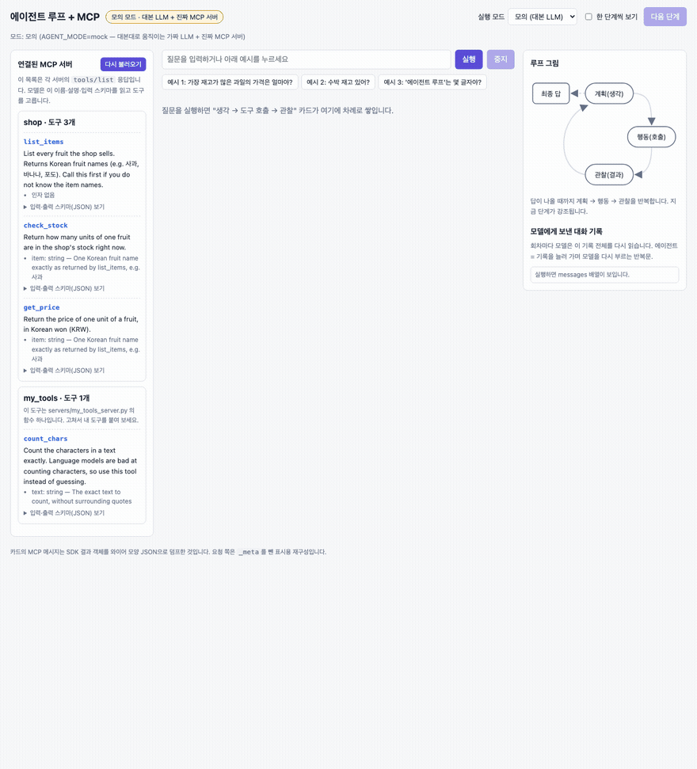
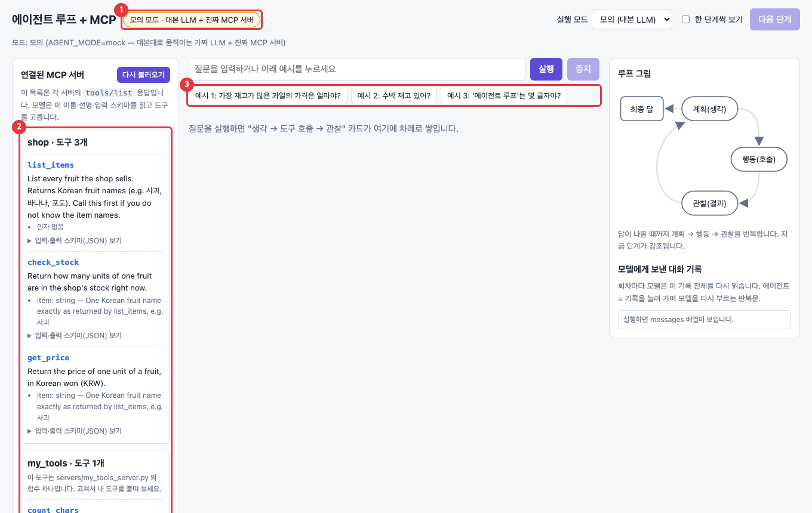
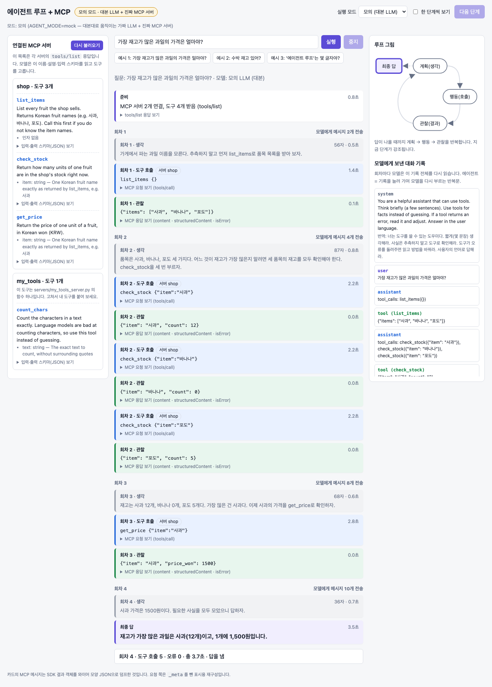
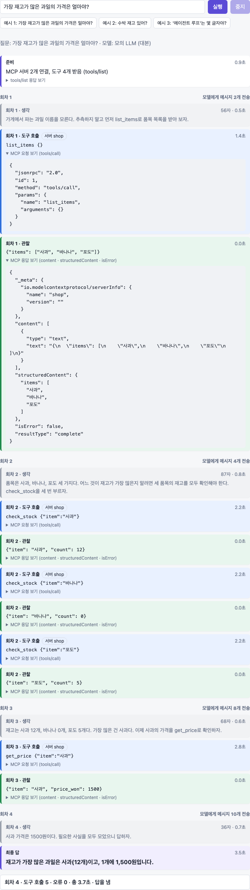
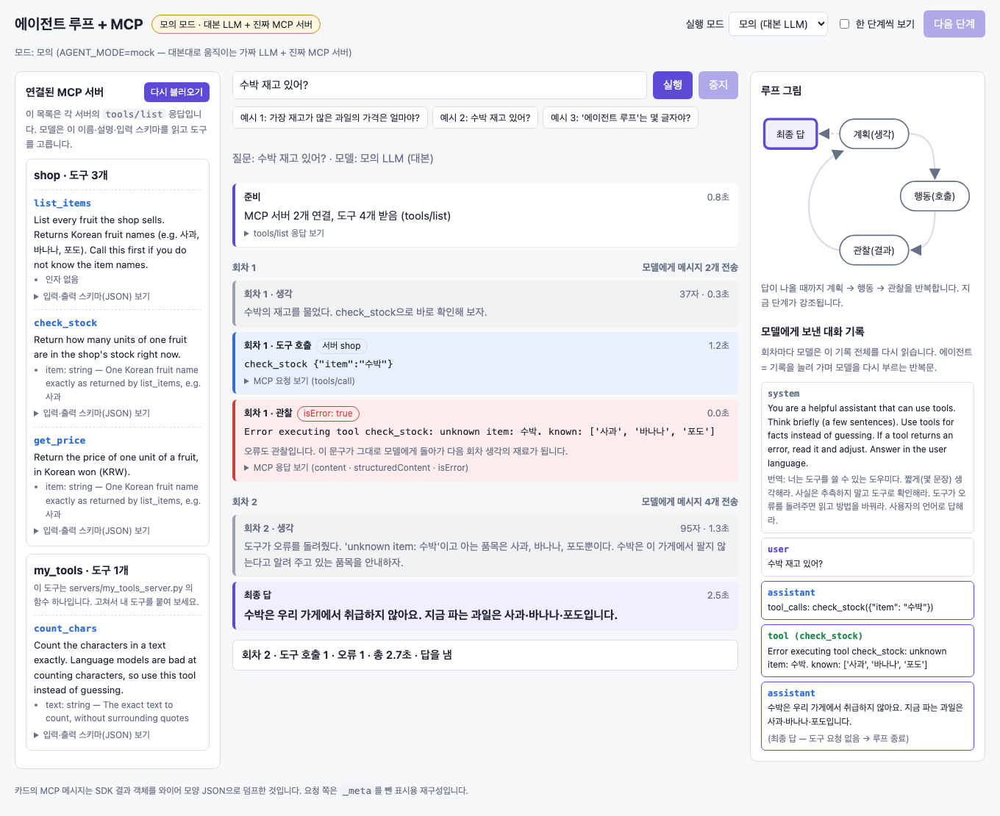
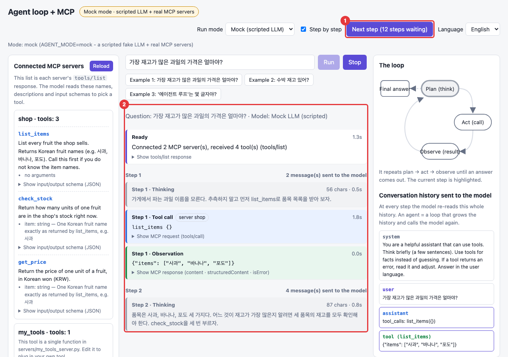
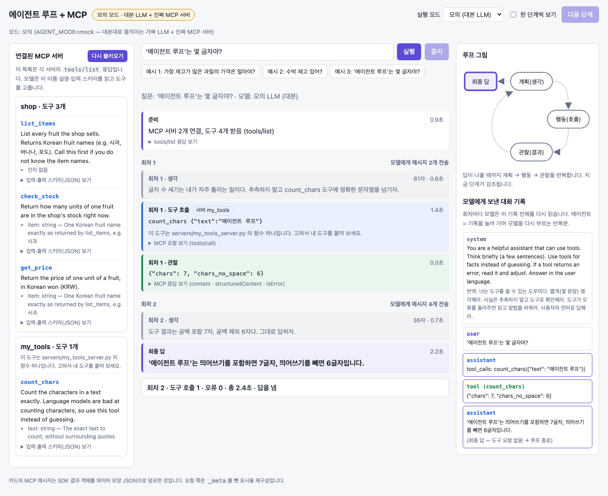
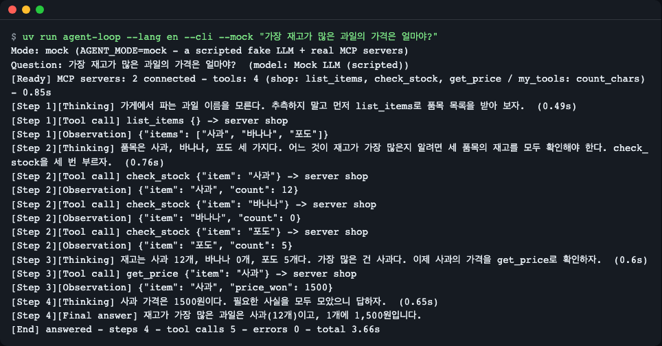
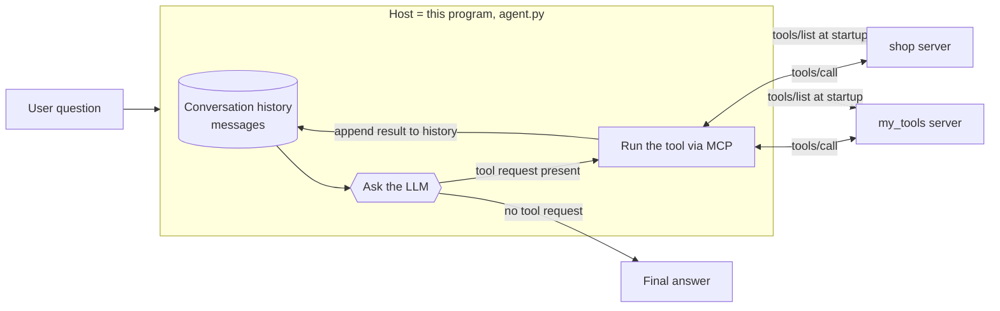

# Agent Loop and MCP — Watch How a Tool-Using AI Moves, One Step at a Time

**English** | [한국어](README.ko.md)

A small, transparent demo of a tool-using AI agent loop (plan → act → observe, repeated) that talks to two MCP (Model Context Protocol) servers. Run `uv run agent-loop --mock` and the browser shows every step: the model's thinking, each `tools/call` request, each result, and the growing message history. Mock mode needs no model and no network; real mode uses a local Ollama model (`qwen3:4b`).


<sub>When you enter one question, "thinking → tool call → observation" cards pile up and the conversation history on the right grows one line at a time. (Recorded in mock mode)</sub>

## One-line summary

You ask an AI a question, the AI requests "please call this tool", the program runs the tool and returns the result, and the AI reads that result and thinks again. You see this **loop** with your own eyes. You also get hands-on with **MCP**, the standard specification for plugging in tools.

**Who this is for:**
- People who have heard the term "AI agent" but don't know what happens inside
- People who wonder what MCP is and why it is called a "standard"
- People who want to attach their own functions as tools for an AI

## Why should you care?

Say you ask a new employee, "What is the price of the fruit we have the most of?" The employee hasn't memorized the stock. So they first look up the item list, check the stock of each item, look up the price of the one with the most, and only then answer. If they hit a snag midway, like "we don't have watermelon", they find another way.

This is what an AI agent does. A model alone can't know our shop's stock, so it repeats the process of **looking up → checking → thinking again**. MCP is the **common specification** for plugging tools like the employee's "stock ledger and price list" into an AI program. With the same specification, a tool you build once can be plugged into other apps as it is.

## Run it in 30 seconds

You need: [git](https://git-scm.com/downloads) + [uv](https://docs.astral.sh/uv/) ([Ollama](https://ollama.com) is needed only for the real-model mode)

If you don't have uv, install it first. **You don't need to install Python 3.14 separately.** If your PC doesn't have it, uv downloads it automatically on the first run.

```bash
# macOS / Linux
curl -LsSf https://astral.sh/uv/install.sh | sh
```

```powershell
# Windows (PowerShell)
powershell -ExecutionPolicy ByPass -c "irm https://astral.sh/uv/install.ps1 | iex"
```

After installing, open a new terminal and run the following.

```bash
git clone https://github.com/LeeGyeongPil/ai-lab-agent-loop-mcp.git
cd ai-lab-agent-loop-mcp
uv run agent-loop --mock
```

The two lines below appear in the terminal and a browser opens. Press `Ctrl+C` to quit.

```text
모드: 모의 (AGENT_MODE=mock — 대본대로 움직이는 가짜 LLM + 진짜 MCP 서버)
주소: http://127.0.0.1:8765  (끝내려면 Ctrl+C)
```

(Mode: mock (AGENT_MODE=mock — a fake LLM that follows a script + real MCP servers). Address: http://127.0.0.1:8765 (Ctrl+C to quit).)

If the browser doesn't open, open the address above yourself. On the first run it takes a little while because uv downloads packages.

**What is mock mode?** It is a mode where a "fake model that speaks from a script" takes the place of the AI model. It runs without a model and the result is the same every time. However, the tool side (the MCP servers) is **real**: the server processes actually start, and messages are actually exchanged.


<sub>The first screen. 1 the current mode, 2 the tool list the servers reported, 3 example questions to click.</sub>

To run with a real local model (downloads about 2.5GB of model):

```bash
ollama pull qwen3:4b
uv run agent-loop --real
```

## Step by step

### Step 1. See the "tool list" on the first screen

Look at **연결된 MCP 서버** ("Connected MCP servers") on the left of the screen. You'll see 3 tools (`list_items`, `check_stock`, `get_price`) on the `shop` server and 1 tool (`count_chars`) on the `my_tools` server.

This list is the answer the program got when it asked each server at startup, "what tools do you have?" In MCP this question is called **`tools/list`**. It contains each tool's **name, description and input format**, and the AI model reads exactly this text to choose which tool to call. In other words, a tool description is the user manual the model reads.

### Step 2. Run example 1 — a loop where results change the next action

Click the button **예시 1: 가장 재고가 많은 과일의 가격은 얼마야?** ("Example 1: What is the price of the fruit with the most stock?"). A few seconds later the screen looks like this.


<sub>Gray is thinking, blue is a tool call, green is an observation (the result the tool returned), and purple is the final answer.</sub>

Read the cards from top to bottom.

1. **Round 1** — Thinking: "I don't know the fruit names. First let's get the list." → tool call `list_items` → observation `["사과", "바나나", "포도"]` (apple, banana, grape)
2. **Round 2** — Thinking: "I need to check the stock of all three." → calls `check_stock` three times → apple 12, banana 0, grape 5
3. **Round 3** — Apple has the most, so it calls `get_price` → 1500 won
4. **Round 4** — There are no more tools to call, so the final answer: "사과(12개), 1개에 1,500원" ("Apple (12), 1,500 won each")

The key point is that **without the result of round 1 (the item list), the action of round 2 could not have been decided.** The observation determines the next action. That is the loop.

Also look at the **모델에게 보낸 대화 기록** ("Conversation history sent to the model") on the right. Entries grow with each round. The model has no memory, so in every round it re-reads "the entire conversation so far" and then says its next words.

### Step 3. Open the MCP messages yourself

Click **MCP 요청 보기 / MCP 응답 보기** ("View MCP request / View MCP response") on the tool-call card and the observation card to expand them.


<sub>The upper request is `tools/call`, and the lower response contains `structuredContent` and `isError`.</sub>

- Request: `"method": "tools/call"`, the tool name and the arguments (`arguments`). This is the MCP message that says "please run this tool with these values."
- Response: `structuredContent` is the JSON result that is easy for a program to read, `content` is the same content as text, and `isError` is whether it failed.

As the note at the bottom of the screen says, the request side is reconstructed for display (it isn't exactly identical to the bytes actually sent).

### Step 4. An error is an observation too

Click **예시 2: 수박 재고 있어?** ("Example 2: Is watermelon in stock?"). This shop has no watermelon.


<sub>The red card is the error observation. This text goes back to the model as is and becomes material for the next round of thinking.</sub>

The tool returns the error `Error executing tool check_stock: unknown item: 수박. known: ['사과', '바나나', '포도']` (the leading `Error executing tool <tool name>:` is a prefix the SDK attaches; "수박" is watermelon). The program does not stop here; it **appends this error to the conversation history as an observation.** The model reads the information that "only three items are possible" and answers "we don't carry watermelon." If you **put a clue for fixing it** in the error text, the model can correct itself.

### Step 5. View one step at a time

Check **한 단계씩 보기** ("View step by step") and run example 1 again. Now each time you click the **다음 단계** ("Next step") button, one card appears.


<sub>1 The button shows the number of steps remaining. 2 Only as many cards appear as you clicked. The loop diagram on the right highlights the current step.</sub>

It is good for taking the loop apart slowly. Before clicking the button, try guessing first: "what will the next card be?"

### Step 6. See your own tool being called (example 3)

Click **예시 3: '에이전트 루프'는 몇 글자야?** ("Example 3: How many characters is '에이전트 루프' (agent loop)?").


<sub>This time `count_chars` of the `my_tools` server was called, not `shop`.</sub>

AI models often get character counting wrong. So the job is handed to a tool that is a few lines of function, and the model reads the result and answers. The code of this tool is in `servers/my_tools_server.py`, and you'll build one more in "Try changing things yourself" below.

### Step 7. The same loop in the terminal

The same loop runs even without a screen.

```bash
uv run agent-loop --cli --mock "가장 재고가 많은 과일의 가격은 얼마야?"
```


<sub>The same events as the web screen, printed as text. The final `[끝]` ("[end]") line summarizes the number of rounds and tool calls.</sub>

The log the MCP server leaves (stderr) is collected in `runs/mcp-server-stderr.log` instead of the terminal so that output doesn't get mixed (rewritten on each run). If a log exists, the end notes it like `[서버 로그] MCP 서버가 남긴 로그 1줄은 runs/mcp-server-stderr.log 에 있습니다.` ("[server log] 1 line of log left by the MCP server is in runs/mcp-server-stderr.log."). If you run example 2 (watermelon), you can see the `Tool 'check_stock' failed: ...` line the server left in this file.

### Step 8. Run with a real model

Run with `uv run agent-loop --real` and a real model (`qwen3:4b`) thinks on the same screen. You can see the text flowing out.

The mock-mode script is the "ideal path". A real model may behave differently. For example, the mock script requests the three stock checks in one round, but in practice `qwen3:4b` called one tool per round, so example 1 went up to round 6. It is also slow because it is a small model. In one measurement (a single PC of mine, sharing Ollama with other work), example 1 took about 87 seconds, 14 seconds until the first tool call, then 9–20 seconds per round afterward.

## How does it work?



Let's go through the diagram one sentence at a time.

1. When a **user question** comes in, the host (this program) builds a **conversation history**. At first it is two lines: the "system instruction" and the "user question".
2. At startup the host sends **`tools/list`** to each MCP server and keeps the tool list. Servers start as child processes as written in `mcp_servers.json` and exchange JSON messages over standard input/output (stdio).
3. The host gives the LLM the **conversation history + tool list**. After thinking, the LLM returns one of two things: a **request** such as "please call this tool with this value", or simply an **answer**.
4. If there is a tool request, the host sends **`tools/call`** to the relevant server to run the tool. **It is the host, not the model, that runs the tool.** The model only writes the request form.
5. The execution result (including errors) is appended to the conversation history and it returns to step 3. This is one **round**.
6. If an answer arrives without a tool request, that is the **final answer** and the loop ends. To prevent infinite repetition, there is a maximum number of rounds (default 8).

MCP's role is steps 2 and 4, that is, it defines **how tools are announced (`tools/list`) and how they are called (`tools/call`)**. Thanks to this specification, the `shop` server can be plugged in the same way into this program and into other apps that support MCP.

## Code tour

| File | What it does |
|---|---|
| [`src/agentloop/agent.py`](src/agentloop/agent.py) | The agent loop itself (`run_agent`) |
| [`src/agentloop/mcp_hub.py`](src/agentloop/mcp_hub.py) | Connecting MCP servers, merging tool lists, calling tools |
| [`src/agentloop/llm.py`](src/agentloop/llm.py) | Streaming thinking from Ollama |
| [`src/agentloop/mock_llm.py`](src/agentloop/mock_llm.py), [`scenarios/`](scenarios) | The scripted model and scripts for mock mode |
| [`servers/shop_server.py`](servers/shop_server.py), [`servers/my_tools_server.py`](servers/my_tools_server.py) | The MCP server side (the side that holds the tools) |
| [`src/agentloop/web.py`](src/agentloop/web.py), [`static/`](src/agentloop/static) | The web screen and event relay |
| [`tests/`](tests) | Tests (they run in mock mode and need no key or model). Run with `uv run pytest` |

**Running the tests:** `uv run pytest` finishes within a minute without a key or model (tests that need a real Ollama are skipped by default, and are run separately with `uv run pytest -m ollama`).

We recommend reading in the order `agent.py` → `mcp_hub.py` → `servers/`. Here are the three key places.

**1. The loop — [`agent.py`](src/agentloop/agent.py)**

```python
for step in range(1, max_steps + 1):
    ...
    async for chunk in llm.stream_turn(messages, tools):   # 1) plan: ask the model
        ...
    if not calls:                                          # 2) no tool request = final answer
        stop_reason = "answer"
        break
    messages.append({"role": "assistant", ..., "tool_calls": [...]})
    for call in calls:
        result = await hub.call(call.name, call.arguments)  # 3) act: MCP tools/call
        messages.append({"role": "tool", "tool_name": call.name,
                         "content": result.observation})    # 4) observe: append to history
```

The identity of the agent is one `for` loop and a growing `messages` list. The reason no framework is used is so that no step is hidden. The "thinking" of earlier rounds is not put into the history, so the history stays shorter and the next round is faster.

**2. Errors as observations, not exceptions — [`mcp_hub.py`](src/agentloop/mcp_hub.py)**

```python
try:
    result = await self.clients[server].call_tool(name, arguments)
except Exception as exc:  # protocol-level errors such as a dropped connection or a timeout
    text = f"host error while calling {name}: {exc}"
    return ToolResult(True, text, {"host_error": text}, elapsed())
```

`hub.call()` never throws an exception outward in any case and instead returns an `is_error=True` result. That goes for an unknown tool name, a server error and a timeout (30 seconds). It is so that an error doesn't stop the program but becomes text the model can read.

**3. One tool = one function — [`servers/my_tools_server.py`](servers/my_tools_server.py)**

```python
@mcp.tool()
def count_chars(
    text: Annotated[str, Field(description="The exact text to count, without surrounding quotes")],
) -> CharCount:
    """Count the characters in a text exactly. Language models are bad at counting characters, so use this tool instead of guessing."""
    no_space = "".join(text.split())
    return {"chars": len(text), "chars_no_space": len(no_space)}
```

A function with `@mcp.tool()` attached becomes a tool. **The function name becomes the tool name, the docstring (the text describing the function) becomes the tool description, and the argument types and `description` become the input format**, and they are delivered to the model through `tools/list`. If you write the return type as a `TypedDict`, a structured JSON result (`structuredContent`) is produced.

## Glossary

| Term | Meaning |
|---|---|
| Agent | A program that repeatedly calls a model while growing a conversation history, and runs on its behalf the tools the model requests |
| Loop | A structure that repeats plan → act → observe until an answer comes out |
| LLM | A large language model that reads text and produces text. In this demo it is `qwen3:4b` or the mock script |
| Tool call | A request the model writes and sends saying "please run this tool with these arguments". The host does the execution |
| Observation | The result of running a tool. Includes errors. It is appended to the conversation history and becomes material for the next thought |
| MCP | Model Context Protocol. A common specification for an AI app and tool servers to exchange tool lists and calls |
| Host / client / server | The host is the AI app (this program), a client is the connection to one server, and a server is the side that holds tools |
| `tools/list` | The MCP request that asks a server for its tool list (name, description, input format) |
| `tools/call` | The MCP request asking to run one tool with arguments |
| `isError` | A value telling whether the tool result is a failure |
| Schema | A description (JSON) of what shape inputs and outputs must have |
| stdio | Standard input/output. A connection method that starts the server as a child process and exchanges messages as lines of text |
| SSE | A method where a server keeps streaming events to the browser. Used so that cards appear one after another on screen |
| Ollama | A program that runs language models on my PC |
| Mock mode | A scripted model + real MCP servers. The same result comes out without a model or network |
| Context length (`num_ctx`) | How much text the model can read at once. If you change it, Ollama reloads the model and the first response gets slower |

## Try changing things yourself

**1. Add your own tool (reverse_text)** — uncomment the commented-out example near the bottom of `servers/my_tools_server.py`.

```python
class Reversed(TypedDict):
    text: str


@mcp.tool()
def reverse_text(text: str) -> Reversed:
    """Return the text with its characters in reverse order."""
    return {"text": text[::-1]}
```

Save, and click the **다시 불러오기** ("Reload") button on the web screen (servers start fresh on each run) and it changes to `my_tools · 도구 2개` ("my_tools · 2 tools") and a `reverse_text` card appears. In the terminal it shows in the `[준비]` ("[ready]") line as `my_tools: count_chars, reverse_text`. Mock mode has scripts only for the 3 example questions, so to actually get the new tool called you have to ask in real mode (`--real`), such as "hello를 거꾸로 써 줘" ("write hello backwards"). If you made a separate new server file, add one line to `mcp_servers.json`.

**2. Reduce the maximum rounds** — reduce the round cap to 2 with an environment variable.

```bash
AGENT_MAX_STEPS=2 uv run agent-loop --cli --mock "가장 재고가 많은 과일의 가격은 얼마야?"
```

Example 1 needs 4 rounds, so it ends like this.

```text
[끝] 최대 회차 도달 · 회차 2 · 도구 호출 4 · 오류 0 · 총 2.85초
```

(Meaning: "[end] maximum rounds reached · round 2 · tool calls 4 · errors 0 · total 2.85 s".)

Stopping without an answer is the role of the "maximum rounds" guard. It protects the program in a situation where the model calls the same tool forever.

**3. What if the error text is hidden?** — change `raise ToolError(` to `raise ValueError(` in `servers/shop_server.py` and run example 2 again. The observation changes like this.

```text
[회차 1][관찰·오류] Error executing tool check_stock
```

(The prefix reads "[round 1][observation·error]".)

Originally (`ToolError`), the cause text follows the prefix, like `Error executing tool check_stock: unknown item: 수박. …`. If you change to a general exception, only the prefix remains and the cause text is hidden. The model can no longer know "what is possible", so the clue for fixing it disappears. (The scripted model in mock mode gives the same answer anyway, but with a real model there is a difference. After checking, put it back as it was.)

## Troubleshooting

| Symptom | Cause | Fix |
|---|---|---|
| `VIRTUAL_ENV ... does not match the project environment` warning | Another Python virtual environment is active in the shell | You can ignore it. To get rid of it, `deactivate` or `env -u VIRTUAL_ENV uv run ...` |
| The server won't start because the address is already in use | Another program uses port 8765 | `uv run agent-loop --port 9000` or `AGENT_PORT=9000` |
| The mode starts as "모의" (mock) | Ollama is off or has no model, or Ollama was busy and didn't answer within 3 seconds | Run `ollama serve` and `ollama pull qwen3:4b`. If the detection wavers, force it with `--real` |
| In real mode the first round seems stuck for a long time | The model is being loaded into memory | Wait through the thinking card's "모델 응답 기다리는 중… n초" ("waiting for the model response… n seconds") |
| In mock mode, asking another question only shows a notice | Scripts exist only for the 3 examples | In real mode (`--real`) any question works |
| A new tool doesn't show on screen | The list wasn't fetched again after editing the server code | The **다시 불러오기** ("Reload") button or a page refresh |
| Error card `도구 이름 '…' 이(가) 서버 'a' 와 'b' 에 모두 있습니다` ("tool name '…' exists on both servers 'a' and 'b'") | The same tool name on two servers | Rename the tool on one side |
| A `Tool '…' failed` line shows in the terminal in web mode | You're seeing the MCP server's log (stderr) | Normal. With `--cli` this log goes to `runs/mcp-server-stderr.log`. Don't use `print()` in server code (standard output is reserved for MCP messages) |
| I started it in Docker, a virtual machine or a remote dev server and can't connect from my PC's browser | The web server by default opens only on `127.0.0.1` (the computer itself) | Open to all addresses with `--host 0.0.0.0`. Docker also needs the port exported: inside `docker run -p 8765:8765 ...`, run `uv run agent-loop --mock --host 0.0.0.0 --no-browser` and then open `http://127.0.0.1:8765`. For a remote server, port forwarding with `ssh -L 8765:127.0.0.1:8765 <server>` is safer than changing `--host` |

**Caution:** An stdio MCP server **runs code on my PC**. The web screen of this demo by default opens only on `127.0.0.1` (my PC). If you pass `--host 0.0.0.0`, other devices on the same network can also run questions (a warning appears at startup), so use it only on a trusted network. When you add a server you didn't write to `mcp_servers.json`, check its code and register only those you trust.

## Versions this demo follows (MCP spec 2026-07-28, Python SDK v2)

Many MCP examples found on the web are based on the old version (SDK v1), and copying them as is produces errors. This demo uses the **2026-07-28** revision of the MCP specification and the official Python SDK **v2**.

- Server class: `from mcp.server.fastmcp import FastMCP` from v1 examples is gone in v2 (ImportError). Use `from mcp.server import MCPServer`.
- Tool errors: to tell the model the cause, throw `ToolError` (a general exception hides the cause text).
- Attribute names are snake_case (`input_schema`, `is_error`).
- The new revision has no `initialize` handshake or session. That explanation in old tutorials does not apply to this demo.
- Changes: [MCP 2026-07-28 changelog](https://modelcontextprotocol.io/specification/2026-07-28/changelog)

## Further reading

- Try another model: `OLLAMA_MODEL=<a model that supports tool calling> uv run agent-loop --real`. This demo was verified only with `qwen3:4b`. The environment variables (`AGENT_MODE`, `OLLAMA_HOST`, `OLLAMA_MODEL`, `OLLAMA_NUM_CTX`, `AGENT_MAX_STEPS`, `AGENT_PORT`, `MOCK_DELAY_MS`, `MCP_SERVERS_FILE`) are described in [.env.example](.env.example).
- Connecting a remote server: this demo uses only stdio. For connecting over HTTP, see the [Streamable HTTP transport specification](https://modelcontextprotocol.io/specification/2026-07-28/basic/transports).
- [MCP specification](https://modelcontextprotocol.io/specification/latest) — the full protocol description
- [MCP Tools specification](https://modelcontextprotocol.io/specification/2026-07-28/server/tools) — `tools/list`, `tools/call`, `isError`
- [MCP stdio transport](https://modelcontextprotocol.io/specification/2026-07-28/basic/transports/stdio) — how to start a server as a child process
- [MCP Python SDK](https://py.sdk.modelcontextprotocol.io/client/) — the client docs of the SDK this demo uses
- [Ollama tool calling](https://docs.ollama.com/capabilities/tool-calling) / [thinking](https://docs.ollama.com/capabilities/thinking)
- Tools that run the same loop for you: [MCP in the OpenAI Agents SDK](https://openai.github.io/openai-agents-python/mcp/), [Pydantic AI's MCP client](https://pydantic.dev/docs/ai/mcp/client/), [smolagents](https://huggingface.co/docs/smolagents/tutorials/tools)

## License

MIT — [LICENSE](LICENSE). The model `qwen3:4b` used in real mode follows a separate license (Apache-2.0).
